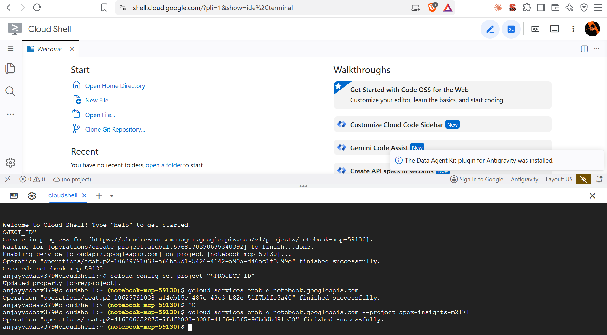

You can connect Gemini Notebook to Claude as a custom connector in about 15 minutes, using Google's MCP server at `https://notebook.googleapis.com/mcp` and an OAuth client you create yourself. Once it's connected, Claude can list your notebooks, read their sources, create notebooks and add web pages or text as sources.

**What you need**

- A Google account that can already open Gemini Notebook
- Access to the Google Cloud Console (no billing account needed)
- A Claude plan that allows custom connectors

There is one rule that isn't obvious. **The OAuth client and the enabled Notebook API must be in the same Google Cloud project.** Most setup failures come from breaking it.

## Step 1. Create a Google Cloud project and enable the API

Create a dedicated project and turn on the Notebook API from the terminal. [Google Cloud Shell](https://shell.cloud.google.com) is the quickest option because it is already signed in. On your own machine, run `gcloud auth login` first.

1. Create the project with a unique ID. Project IDs are shared across all of Google Cloud, so a fixed name like `my-notebook-mcp` is probably taken already.

    ```bash
    PROJECT_ID="notebook-mcp-$(date +%s | tail -c 6)"; gcloud projects create "$PROJECT_ID" --name="Notebook MCP" && echo "Created: $PROJECT_ID"
    ```

2. Make it the default project.

    ```bash
    gcloud config set project "$PROJECT_ID"
    ```

3. Enable the Notebook API.

    ```bash
    gcloud services enable notebook.googleapis.com
    ```



Here is what it looks like in Cloud Shell when it works. Each step ends with **finished successfully** or **done**, and the project ID appears in yellow in the prompt once it's set.



The last command in this screenshot enables the API in a second project, the one that held the OAuth client. You only need that if you hit the 403 error in Troubleshooting.

Each command ends with **finished successfully** or **done** when it works.


Write down the project ID. Before each console step that follows, **select this same project in the console's project picker**.

## Step 2. Configure the OAuth consent screen

Google requires a consent screen before it will let you create an OAuth client. Do this in the [Cloud Console](https://console.cloud.google.com), with your new project selected.

1. Open **APIs & Services → OAuth consent screen**. Newer consoles call this **Google Auth Platform**. If a **Get started** button appears, click it.
2. Enter an app name, such as "Claude Notebook", and choose your email as the support email.
3. Under **Audience**, choose **External**.
4. Enter a contact email, accept the terms and click **Create**.
5. Open **Audience → Test users → Add users** and add the Google account you use for Gemini Notebook.

Step 5 is required. Without it, signing in from Claude fails with "access blocked".

## Step 3. Create the OAuth client

The OAuth client gives Claude a client ID and secret it uses to sign you in to Google. Create it in the same project.

1. Open **APIs & Services → Credentials**, or **Google Auth Platform → Clients** in newer consoles.
2. Click **Create credentials → OAuth client ID**.
3. Set **Application type** to **Web application**, and give it a name, such as "Claude".
4. Under **Authorized redirect URIs**, click **Add URI** and paste this exactly.

    ```
    https://claude.ai/api/mcp/auth_callback
    ```

5. Click **Create**.
6. Keep the window that appears open. It shows the **Client ID** and **Client secret** you need in Step 4.

Newer consoles may not show the secret again, so copy it now, and treat it like a password.

## Step 4. Add the custom connector in Claude

1. In Claude, go to **Settings → Connectors → Add custom connector**.
2. Give it a name, such as "Notebook", and set the URL to the Notebook MCP server.

    ```
    https://notebook.googleapis.com/mcp
    ```

3. Open **Advanced settings** and paste the **OAuth Client ID** and **OAuth Client Secret** from Step 3.
4. Click **Add**, then **Connect**, and sign in with the account you added as a test user.
5. Google warns that the app isn't verified. That's expected for an app you made yourself in testing mode. Click **Advanced → Go to (app name)**, then allow every permission it asks for.

## Step 5. Test the connection

Start a **new** chat or session, so Claude loads the new connector, and ask

> List all my notebooks in Gemini Notebook.

If it's working, Claude replies with your notebook titles and creation dates. These are the tools the connector provides.

| Tool | What it does |
| --- | --- |
| `list_notebooks` | Lists notebooks you own or that are shared with you |
| `get_notebook` | Gets one notebook's details |
| `create_notebook` | Creates a new notebook |
| `update_notebook` | Renames a notebook |
| `list_sources` | Lists the sources in a notebook |
| `get_source` | Gets one source's details and processing state |
| `create_source` | Adds a web URL or text (plain or Markdown) as a source |

## Troubleshooting

| Symptom | Cause | Fix |
| --- | --- | --- |
| `The project ID you specified is already in use` | Another Google Cloud user already has that project ID | Use the random suffix command in Step 1 |
| **403 Forbidden** when Claude calls the connector | The Notebook API is enabled in a different project from the one holding the OAuth client | Enable it in the client's project with `gcloud services enable notebook.googleapis.com --project=<CLIENT_PROJECT_ID>`, wait 1 to 2 minutes, then retry |
| "Access blocked" when signing in | Your account isn't on the consent screen's test user list | Add it under **Audience → Test users** |
| "Google hasn't verified this app" | Normal for an app of your own in testing mode | Click **Advanced → Go to (app name)** |
| `redirect_uri_mismatch` | The redirect URI is missing or mistyped | Set it to exactly `https://claude.ai/api/mcp/auth_callback` |
| Claude doesn't show any Notebook tools | The chat or session started before you connected | Start a new chat or session |

To find which project the OAuth client is in, open **APIs & Services → Credentials** in each project and look for your client. The project marked as current in the console's picker is often a different one from the project gcloud just created.
